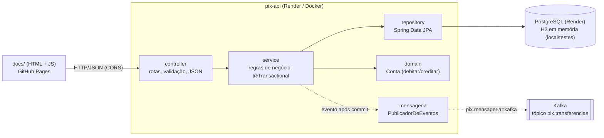
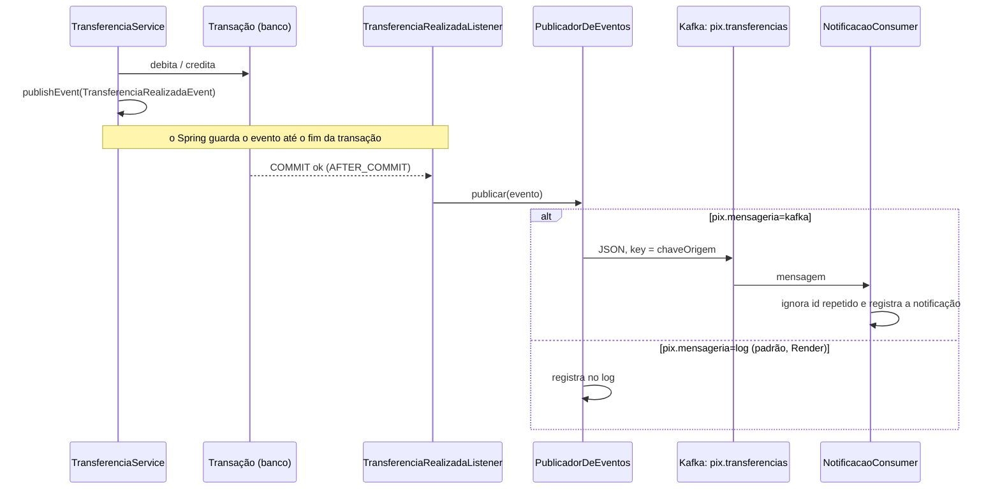

# pix-api

API REST de estudo que simula contas e transferências Pix, feita com **Spring Boot 4 + Java 17**,
com um front-end estático em [`docs/`](docs/) publicado no GitHub Pages.

| | Link |
|---|---|
| Front-end (GitHub Pages) | https://rafaelnicolauios.github.io/pix-api/ |
| Atividade (eventos e logs) | https://rafaelnicolauios.github.io/pix-api/atividade.html |
| API (Render) | https://pix-api-vfy6.onrender.com |
| Código | https://github.com/RafaelNicolauiOS/pix-api |

> A API roda no plano gratuito do Render: depois de ~15 min sem uso ela "dorme", e a primeira
> requisição leva ~50 s para acordar. A página mostra "Acordando o servidor…" enquanto isso.

## Stack

- **Java 17** (Eclipse Temurin) e **Spring Boot 4.1.2**: Web MVC, Data JPA, Validation
- **PostgreSQL** em produção (Render) e **H2** em memória localmente e nos testes
- **Flyway** para versionar o schema do banco (o mesmo script roda nos dois bancos)
- **Spring Kafka** para publicar eventos de domínio (opcional; no Render os eventos vão para o log)
- **JUnit 5 + Mockito + MockMvc** para testes (desenvolvidos com TDD)
- **Maven** via wrapper (`./mvnw`), sem precisar instalar o Maven
- **Docker** + **Render** para a API; **GitHub Pages** para o front-end (HTML + JS puro, sem build)

## Arquitetura

Arquitetura em camadas: cada camada só conversa com a de baixo.



| Pacote | Responsabilidade | Paralelo com iOS/Swift |
|---|---|---|
| `controller` | Recebe HTTP, valida DTOs (`@Valid`), converte exceções em ProblemDetail | Camada de rede/API |
| `controller.dto` | `record`s de entrada/saída: a API não expõe a entidade JPA | `Codable` structs |
| `service` | Casos de uso: CRUD de contas e transferência (transacional) | ViewModel / UseCase |
| `repository` | Acesso ao banco; o Spring gera a implementação a partir da interface | DataSource / Core Data |
| `domain` | Entidade `Conta` com as regras que a protegem (saldo nunca fica negativo) | Model |
| `mensageria` | Implementações do `PublicadorDeEventos` (Kafka, log), listener e consumidor de exemplo | Adapters de um `protocol` |
| `monitoramento` | Últimos eventos e últimas linhas de log em memória, para a página Atividade | Um "console" de debug |
| `config` | CORS e carga das contas de exemplo | `AppDelegate` / configuração |

<details>
<summary>Estrutura de arquivos</summary>

```
pix-api/
├── src/main/java/com/rafael/pixapi/
│   ├── PixApiApplication.java
│   ├── config/        CorsConfig, DadosIniciais
│   ├── controller/    ContaController, TransferenciaController, ApiExceptionHandler
│   │   └── dto/       ContaRequest, ContaResponse, TransferenciaRequest
│   ├── service/       ContaService, TransferenciaService, ComprovanteTransferencia, exceções,
│   │                  TransferenciaRealizadaEvent, PublicadorDeEventos
│   ├── mensageria/    TransferenciaRealizadaListener, LogPublicadorDeEventos,
│   │                  KafkaPublicadorDeEventos, KafkaConfig, NotificacaoConsumer
│   ├── monitoramento/ HistoricoDeEventos, LogsEmMemoria, LinhaDeLog, MonitoramentoConfig
│   ├── repository/    ContaRepository
│   └── domain/        Conta, SaldoInsuficienteException
├── src/main/resources/
│   ├── application.properties        configuração padrão (H2)
│   ├── application-prod.properties   perfil de produção (PostgreSQL)
│   └── db/migration/                 scripts do Flyway (V1__criar_tabela_conta.sql)
├── src/test/java/...  testes (ver "Como testar")
├── docs/              front-end: index.html + app.js, atividade.html + atividade.js, style.css
├── Dockerfile
├── render.yaml
└── pom.xml
```
</details>

### Decisões importantes

- **Transferência transacional:** `TransferenciaService.transferir` é `@Transactional`: débito e
  crédito são "tudo ou nada". Se o débito falhar (saldo insuficiente), nada é gravado. Não há
  `save()` explícito: o JPA detecta as mudanças nas entidades ("dirty checking") e grava no commit.
- **Concorrência:** as contas são lidas com `SELECT ... FOR UPDATE` (`@Lock(PESSIMISTIC_WRITE)`)
  e travadas sempre em ordem alfabética da chave, para evitar gasto duplo e deadlock.
- **Dinheiro em `BigDecimal`**, nunca `double`, com valor limitado a 2 casas decimais.
- **Regra no domínio:** só `Conta.debitar()` / `Conta.creditar()` alteram o saldo (encapsulamento).
- **Erros no padrão [RFC 9457 – Problem Details](https://www.rfc-editor.org/rfc/rfc9457)**
  (`application/problem+json`), centralizados em `ApiExceptionHandler`.
- **Persistência com PostgreSQL + perfis do Spring:** o perfil `prod`
  ([`application-prod.properties`](src/main/resources/application-prod.properties)), ativado por
  `SPRING_PROFILES_ACTIVE=prod` no Render, troca o H2 pelo PostgreSQL. As credenciais vêm de
  variáveis de ambiente injetadas pelo Render; nenhuma senha fica no repositório.
- **Schema versionado com Flyway:** as tabelas são criadas por scripts em
  [`db/migration`](src/main/resources/db/migration), aplicados uma única vez e registrados na
  tabela `flyway_schema_history`. O Hibernate roda com `ddl-auto=validate`: só confere se as
  entidades batem com o banco e nunca o altera. Para mudar o schema, crie um novo
  `V2__descricao.sql` (nunca edite um script já aplicado).
- **Listagem ordenada por `id`:** sem `ORDER BY` o PostgreSQL devolve as linhas em qualquer
  ordem (as alteradas costumam ir para o fim); o H2 escondia isso.
- **Dados de exemplo** via `CommandLineRunner` (`config/DadosIniciais.java`) em vez de `data.sql`:
  reaproveita o construtor da entidade e só insere quando o banco está vazio (em produção, só no
  primeiro deploy).
- **CORS** liberado só para `https://rafaelnicolauios.github.io` e `localhost` (qualquer porta).
- **Eventos publicados só após o commit:** ver [Mensageria](#mensageria-eventos).

## Mensageria (eventos)

Cada transferência concluída gera o evento **`TransferenciaRealizadaEvent`**
(`id`, `chaveOrigem`, `chaveDestino`, `valor`, `realizadaEm`), para que outros sistemas
(notificações, antifraude, extrato...) reajam sem que o `TransferenciaService` precise conhecê-los.



**Como funciona e por quê:**

1. **O service só anuncia o fato.** `TransferenciaService` chama
   `ApplicationEventPublisher.publishEvent(...)`, o "NotificationCenter" interno do Spring.
   Ele não sabe se o evento vai para o Kafka, para o log ou para lugar nenhum.
2. **Nada sai antes do commit.** `TransferenciaRealizadaListener` usa
   `@TransactionalEventListener(phase = AFTER_COMMIT)`: o Spring segura o evento e só chama o
   listener depois que o banco confirmou a transação. Com saldo insuficiente, chave inexistente
   ou qualquer rollback, o evento é descartado. Assim nunca avisamos de uma transferência que
   não aconteceu. (Um `@EventListener` comum dispararia na hora, e o teste
   `PublicacaoAposCommitTest` falha se trocarmos um pelo outro.)
3. **Porta e adaptadores.** `PublicadorDeEventos` é uma interface do pacote `service`, como um
   `protocol` em Swift. A implementação é escolhida pela propriedade `pix.mensageria`:

   | `pix.mensageria` | Implementação | Uso |
   |---|---|---|
   | `log` (padrão) | `LogPublicadorDeEventos` | Render e desenvolvimento sem broker: só registra no log |
   | `kafka` | `KafkaPublicadorDeEventos` | Envia ao tópico `pix.transferencias` |

   No modo `log` nenhum bean de Kafka é criado, então a aplicação nem tenta conectar a um broker.
4. **Mensagem em JSON, com a chave Pix de origem como *key*.** O Kafka envia mensagens com a mesma
   key para a mesma partição, o que mantém a ordem dos eventos de cada conta. O JSON é gerado pela
   própria aplicação (sem nomes de classes Java no payload), legível por consumidores em qualquer
   linguagem.
5. **Consumidor idempotente.** O Kafka entrega "pelo menos uma vez": a mesma mensagem pode chegar
   repetida. O `NotificacaoConsumer` usa o `id` do evento para ignorar duplicatas.

Exemplo de mensagem no tópico:

```json
{"id":"9ad998de-6f5f-472a-8552-3b963c83d626","chaveOrigem":"ana@pix.com",
 "chaveDestino":"bruno@pix.com","valor":12.34,"realizadaEm":"2026-10-25T16:16:25.300Z"}
```

### Limitação atual e evolução: Transactional Outbox

O `AFTER_COMMIT` resolve metade do problema: **nunca publicamos algo que sofreu rollback**. Mas a
transferência e o envio ao Kafka continuam sendo duas operações separadas (*dual write*). Se a
aplicação cair, ou o Kafka estiver fora do ar, **logo depois do commit**, a transferência fica
gravada e o evento se perde. Hoje isso só aparece como um erro no log.

A evolução é o padrão **[Transactional Outbox](https://microservices.io/patterns/data/transactional-outbox.html)**:

1. Na **mesma transação** da transferência, gravar o evento numa tabela `outbox` do banco.
   Ou tudo é salvo, ou nada é.
2. Um processo separado (um `@Scheduled` lendo a tabela, ou CDC com
   [Debezium](https://debezium.io/documentation/reference/stable/transformations/outbox-event-router.html))
   lê os eventos pendentes, envia ao Kafka e marca como enviados, tentando de novo em caso de falha.
3. Como uma reenviada pode duplicar mensagens, os consumidores continuam idempotentes pelo `id`
   (o que o `NotificacaoConsumer` já faz).

Nesta arquitetura, a mudança fica contida: um novo `PublicadorDeEventos` (ou o próprio listener,
na fase `BEFORE_COMMIT`) grava na tabela `outbox`, e o `TransferenciaService` não muda.

## Endpoints

| Método | Rota | Corpo | Respostas |
|---|---|---|---|
| `GET` | `/contas` | — | 200 |
| `GET` | `/contas/{id}` | — | 200 · 404 |
| `POST` | `/contas` | `{titular, cpf, chavePix, saldo}` | 201 + `Location` · 400 · 409 |
| `PUT` | `/contas/{id}` | `{titular, cpf, chavePix, saldo}` (altera titular e chave) | 200 · 400 · 404 · 409 |
| `DELETE` | `/contas/{id}` | — | 204 · 404 |
| `POST` | `/transferencias` | `{chaveOrigem, chaveDestino, valor}` | 200 · 400 · 404 · 422 |
| `GET` | `/eventos` | — | 200: últimas 100 transferências confirmadas (mais recente primeiro) |
| `GET` | `/logs?limite=200` | cabeçalho `X-Admin-Token` | 200: últimas linhas de log (máx. 500) · 401 · 404 se desativado |

| Status | Quando |
|---|---|
| 400 | Dados inválidos: campo vazio, CPF sem 11 dígitos, saldo negativo, valor ≤ 0 ou com mais de 2 casas |
| 404 | Conta ou chave Pix não encontrada |
| 409 | Chave Pix já cadastrada |
| 422 | Saldo insuficiente, ou chave de origem igual à de destino |

Contas de exemplo, criadas quando o banco está vazio:

| Titular | Chave Pix | Saldo |
|---|---|---|
| Ana Souza | `ana@pix.com` | R$ 1.000,00 |
| Bruno Lima | `bruno@pix.com` | R$ 250,00 |
| Carla Dias | `+5511999990000` | R$ 50,00 |

<details>
<summary>Exemplos de resposta</summary>

Transferência com sucesso (`200`):

```json
{
  "chaveOrigem": "ana@pix.com",
  "chaveDestino": "bruno@pix.com",
  "valor": 100.50,
  "saldoOrigem": 899.50,
  "realizadaEm": "2026-10-25T14:43:59.442257Z"
}
```

Saldo insuficiente (`422`, `application/problem+json`):

```json
{
  "title": "Saldo insuficiente",
  "status": 422,
  "detail": "Saldo insuficiente na chave +5511999990000 para transferir R$ 50.01",
  "instance": "/transferencias"
}
```

Dados inválidos (`400`):

```json
{
  "title": "Bad Request",
  "status": 400,
  "detail": "Dados inválidos",
  "instance": "/contas",
  "erros": {
    "cpf": "deve conter 11 dígitos",
    "saldo": "deve ser maior ou igual a 0",
    "titular": "não deve estar em branco"
  }
}
```
</details>

## Página Atividade (eventos e logs)

https://rafaelnicolauios.github.io/pix-api/atividade.html (ou o ícone de "pulso" no topo da tela
inicial) acompanha a API em tempo real, atualizando a cada 5 segundos enquanto a aba está visível.

| Aba | Fonte | Acesso |
|---|---|---|
| **Eventos** | `GET /eventos` | Público: mostra os mesmos dados de `GET /contas` |
| **Logs do servidor** | `GET /logs` | Restrito: exige o token de administrador |

**Por que os logs têm token e os eventos não?** Logs revelam detalhes internos (erros, endereços
do banco, nomes de classes). Por isso `GET /logs`:

- exige o cabeçalho `X-Admin-Token` igual à variável `PIX_ADMIN_TOKEN`, comparado em tempo
  constante (`MessageDigest.isEqual`) para não vazar informação pelo tempo de resposta;
- fica **desativado (404)** quando `PIX_ADMIN_TOKEN` não está definido (o padrão local);
- no Render, recebe um token aleatório gerado pelo próprio Render (`generateValue: true` no
  `render.yaml`). Para ver: **dashboard → pix-api → Environment → `PIX_ADMIN_TOKEN`**.

Na página, o token fica no `sessionStorage`: vale só para aquela aba e some ao fechá-la.

**Como funciona por dentro:**

- **Eventos:** um segundo listener `AFTER_COMMIT` (independente do modo `log`/`kafka`) guarda
  os últimos 100 `TransferenciaRealizadaEvent` em `HistoricoDeEventos`.
- **Logs:** `LogsEmMemoria` adiciona um *appender* ao Logback (o sistema de log do Spring Boot)
  que copia cada linha, além do console, para um buffer com as últimas 500.
- Os dois ficam **em memória**: recomeçam quando a API reinicia, e linhas do início do boot (antes
  de o componente existir) não aparecem. O log completo continua na aba **Logs** do Render.

Para testar localmente com logs habilitados:

```bash
PIX_ADMIN_TOKEN=um-token-local ./mvnw spring-boot:run
```

```bash
curl -s "localhost:8080/logs?limite=20" -H "X-Admin-Token: um-token-local"
```

## Como rodar localmente

Pré-requisito: JDK 17.

```bash
brew install --cask temurin@17
```

E no `~/.zshrc`:

```bash
export JAVA_HOME=$(/usr/libexec/java_home -v 17)
export PATH="$JAVA_HOME/bin:$PATH"
```

Subir a API:

```bash
./mvnw spring-boot:run
```

- API: http://localhost:8080
- Console do banco: http://localhost:8080/h2-console (JDBC URL `jdbc:h2:mem:pixdb`, usuário `sa`, senha vazia)

Subir o front-end (em outro terminal):

```bash
python3 -m http.server 8000 --directory docs
```

Abra http://localhost:8000. Rodando local, a página usa `http://localhost:8080` automaticamente.

<details>
<summary>Rodar localmente com Kafka</summary>

Os testes não precisam de Kafka instalado (usam `@EmbeddedKafka`). Para ver a mensageria rodando
de verdade, suba um broker em `localhost:9092`, por exemplo com Docker:

```bash
docker run -d --name kafka -p 9092:9092 apache/kafka:4.0.0
```

E rode a API no modo Kafka:

```bash
PIX_MENSAGERIA=kafka ./mvnw spring-boot:run
```

A cada transferência aparecem no log `Evento ... publicado em pix.transferencias-<partição>@<offset>`
e `Notificação para <chave>: você recebeu um Pix de R$ ...`.
</details>

<details>
<summary>Rodar localmente com PostgreSQL (igual à produção)</summary>

Com um PostgreSQL local (`brew install postgresql@17`) e um banco `pix` com usuário `pix`:

```bash
./mvnw -q -DskipTests package
```

```bash
SPRING_PROFILES_ACTIVE=prod DB_HOST=localhost DB_PORT=5432 DB_NAME=pix DB_USER=pix DB_PASSWORD=pix java -jar target/pix-api-0.0.1-SNAPSHOT.jar
```

No log aparece `Successfully applied 1 migration` na primeira vez e
`Schema "public" is up to date` nas seguintes. Os dados continuam após reiniciar.
</details>

## Como testar

```bash
./mvnw test
```

**60 testes**, todos escritos antes da implementação (TDD: vermelho → verde). Eles rodam com H2
e Kafka embutido, sem precisar de PostgreSQL, Kafka ou Docker instalados:

| Teste | Tipo | Qtd. | O que cobre |
|---|---|---|---|
| `domain/ContaTest` | Unidade pura | 4 | Débito, crédito e saldo insuficiente |
| `service/ContaServiceTest` | Unidade com Mockito | 9 | CRUD, listagem ordenada e chave Pix duplicada, com repositório mockado |
| `service/TransferenciaServiceTest` | Unidade com Mockito | 6 | Débito/crédito, publicação do evento e nenhuma publicação em saldo insuficiente, chave inexistente ou origem = destino |
| `controller/ContaControllerTest` | `@WebMvcTest` | 9 | Rotas, status, JSON e validação de contas |
| `controller/TransferenciaControllerTest` | `@WebMvcTest` | 5 | 200, 400, 404 e 422 no formato ProblemDetail |
| `config/CorsConfigTest` | `@WebMvcTest` | 4 | GitHub Pages e localhost permitidos, cabeçalho do token liberado, outros domínios bloqueados |
| `TransferenciaIntegrationTest` | `@SpringBootTest` + H2 | 3 | Débito/crédito gravados de verdade, rollback e contas de exemplo |
| `MigracaoBancoTest` | `@SpringBootTest` | 1 | Migrações do Flyway aplicadas, nenhuma pendente |
| `mensageria/PublicacaoAposCommitTest` | `@SpringBootTest` + mock do publicador | 3 | Evento só após o commit; nada com saldo insuficiente nem com rollback |
| `mensageria/KafkaMensageriaIntegrationTest` | `@SpringBootTest` + `@EmbeddedKafka` | 3 | Transferência → mensagem no tópico → notificação; duplicata ignorada |
| `monitoramento/HistoricoDeEventosTest` | Unidade pura | 2 | Ordem (mais recente primeiro) e capacidade do histórico |
| `monitoramento/HistoricoEventosIntegrationTest` | `@SpringBootTest` | 2 | Transferência confirmada aparece em `/eventos`; recusada não |
| `monitoramento/LogsEmMemoriaTest` | Logback real | 3 | Captura nível, logger, mensagem e exceção; mantém só as mais recentes |
| `controller/LogsControllerTest` | `@WebMvcTest` (`@Nested`) | 5 | 401 sem token ou com token errado, 200 com o certo, limite máximo, 404 sem token configurado |
| `PixApiApplicationTests` | `@SpringBootTest` | 1 | A aplicação sobe (e o `ddl-auto=validate` aceita o schema) |

### Teste manual com curl

Local (troque por `https://pix-api-vfy6.onrender.com` para testar em produção):

```bash
API=http://localhost:8080
```

Listar contas:

```bash
curl -s $API/contas
```

Transferência com sucesso:

```bash
curl -s -X POST $API/transferencias -H 'Content-Type: application/json' -d '{"chaveOrigem":"ana@pix.com","chaveDestino":"bruno@pix.com","valor":100.50}'
```

Saldo insuficiente (422):

```bash
curl -s -X POST $API/transferencias -H 'Content-Type: application/json' -d '{"chaveOrigem":"+5511999990000","chaveDestino":"ana@pix.com","valor":999}'
```

Chave inexistente (404):

```bash
curl -s -X POST $API/transferencias -H 'Content-Type: application/json' -d '{"chaveOrigem":"ana@pix.com","chaveDestino":"ninguem@pix.com","valor":1}'
```

## Configuração

Propriedades em [`application.properties`](src/main/resources/application.properties),
sobrescrevíveis por variáveis de ambiente:

| Propriedade | Variável de ambiente | Padrão | Uso |
|---|---|---|---|
| `spring.profiles.active` | `SPRING_PROFILES_ACTIVE` | — | `prod` ativa o PostgreSQL |
| `server.port` | `PORT` | `8080` | Porta HTTP (o Render define `PORT`) |
| `pix.cors.origens` | `PIX_CORS_ORIGENS` | GitHub Pages + `localhost:*` | Origens liberadas no CORS (separadas por vírgula) |
| `spring.h2.console.enabled` | `H2_CONSOLE` | `true` | Console do H2 (desligado no perfil `prod`) |
| `spring.jpa.show-sql` | `SHOW_SQL` | `true` | Log do SQL gerado (desligado no perfil `prod`) |
| `pix.seed.enabled` | `PIX_SEED_ENABLED` | `true` | Carga das contas de exemplo |
| `pix.mensageria` | `PIX_MENSAGERIA` | `log` | Destino dos eventos: `log` ou `kafka` |
| `pix.admin.token` | `PIX_ADMIN_TOKEN` | vazio | Token do `GET /logs`; vazio = endpoint desativado (no Render é gerado automaticamente) |
| `spring.kafka.bootstrap-servers` | `KAFKA_BOOTSTRAP_SERVERS` | `localhost:9092` | Endereço do broker (só no modo `kafka`) |

Só no perfil `prod` (preenchidas pelo Render a partir do banco `pix-db`):

| Variável | Uso |
|---|---|
| `DB_HOST`, `DB_PORT`, `DB_NAME` | Endereço do PostgreSQL (`jdbc:postgresql://DB_HOST:DB_PORT/DB_NAME`) |
| `DB_USER`, `DB_PASSWORD` | Credenciais do banco |

## Deploy

Todo `git push` na `main` publica as duas partes automaticamente: o Render refaz o deploy da API
(`autoDeploy: true`) e o GitHub Pages republica `docs/`.

### Código no GitHub (via SSH)

O repositório precisa existir vazio no GitHub (crie em https://github.com/new, sem README).
Depois, dentro da pasta `pix-api`:

```bash
git remote add origin git@github.com:RafaelNicolauiOS/pix-api.git
```

```bash
git push -u origin main
```

### API no Render

1. No [Render](https://dashboard.render.com): **New → Blueprint** → selecione o repositório.
2. Em **Blueprint Name** digite `pix-api`; deixe **Branch** = `main` e **Blueprint Path** em branco.
3. **Deploy Blueprint.** O [`render.yaml`](render.yaml) cria:
   - o banco **PostgreSQL `pix-db`** (plano gratuito), e
   - o web service **`pix-api`** usando o [`Dockerfile`](Dockerfile) (build multi-stage: compila
     com JDK, roda só com JRE, sem root), já com o perfil `prod` e as credenciais do banco.

   O primeiro build leva de 5 a 10 minutos; o serviço está pronto quando o status fica **Live**.
   Mudanças no `render.yaml` enviadas por push são sincronizadas automaticamente pelo Blueprint.
4. Se o nome já estiver em uso, o Render acrescenta um sufixo à URL (aqui ficou
   `pix-api-vfy6.onrender.com`). Copie a URL do topo da página do serviço para `API_PRODUCAO` em
   [`docs/app.js`](docs/app.js).

### Front-end no GitHub Pages

No **repositório** (não nas configurações do perfil):
**Settings → Pages → Build and deployment → Deploy from a branch → `main` / `/docs` → Save.**

Em 1–2 minutos fica disponível em https://rafaelnicolauios.github.io/pix-api/. O repositório
precisa ser público no plano gratuito.

## Solução de problemas

| Sintoma | Causa / solução |
|---|---|
| `fatal: not a git repository` | O comando rodou fora da pasta do projeto. Entre em `pix-api/` antes. |
| Tela "Pages → Verified domains" | Essas são as configurações da **conta**. O Pages se ativa em Settings do **repositório**. |
| Página: "Sem conexão com a API" | API dormindo (aguarde ~1 min), URL errada no campo "URL da API" ou origem fora do CORS. |
| `404` com header `x-render-routing: no-server` | Não há serviço nessa URL do Render: confira a URL real no dashboard. |
| Atividade → Logs: "Token inválido" | Copie de novo o valor de `PIX_ADMIN_TOKEN` em **Render → pix-api → Environment**. |
| Atividade → Logs: "Os logs estão desativados" | A API não tem `PIX_ADMIN_TOKEN` definido. No Render, rode **Manual Sync** no Blueprint para criar a variável. |
| Página usa uma URL antiga da API | O botão **Salvar** guarda a URL no navegador (`localStorage`). Corrija o campo e salve de novo. |
| Contas voltam aos valores iniciais (local) | Esperado: localmente o H2 é em memória e zera a cada reinício. |
| Contas voltam aos valores iniciais (Render) | O serviço não está usando o PostgreSQL: confira se `SPRING_PROFILES_ACTIVE=prod` e as variáveis `DB_*` estão em **Environment**, e se o banco `pix-db` existe. |
| `Schema validation: missing table [conta]` | O Hibernate não achou a tabela: verifique se o Flyway rodou (log `Migrating schema`) e se o script está em `db/migration`. |
| `Validate failed: Migrations have failed validation` | Um script já aplicado foi editado. Desfaça a edição e crie um novo `V<n>__...sql`. |
| Postgres local: `postmaster became multithreaded during startup` | No macOS, inicie com `LC_ALL=en_US.UTF-8`. |
| Build Maven falha com `Non-resolvable parent POM` | A versão do Spring Boot no `pom.xml` deve ser `4.1.2` (sem sufixo `.RELEASE`). |

## Limitações

- **PostgreSQL gratuito do Render expira:** o banco do plano free tem prazo de validade
  (confira o prazo atual no dashboard do Render). Depois disso é preciso recriá-lo ou migrar
  para um plano pago; os dados não são preservados.
- **Sem histórico:** transferências não são registradas; só os saldos mudam.
- **Sem autenticação:** qualquer pessoa com acesso à página pode cadastrar, excluir e transferir.
- **Cold start** de ~50 s no plano gratuito do Render.

## Próximos passos

- Transactional Outbox para garantir a entrega dos eventos (ver [Mensageria](#mensageria-eventos)).
- Entidade `Transferencia` com histórico e um `GET /contas/{id}/extrato`.
- Idempotência no `POST /transferencias` (header `Idempotency-Key`) para evitar duplicidade em retries.
- GitHub Actions rodando `./mvnw test` a cada push e bloqueando o deploy se falhar.
- Autenticação (Spring Security) para que cada usuário só movimente a própria conta.
