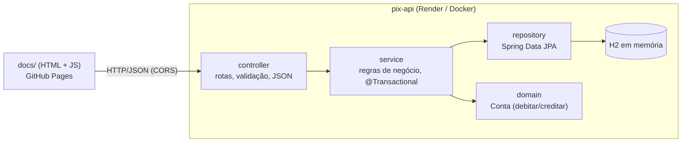

# pix-api

API REST de estudo que simula contas e transferências Pix, feita com **Spring Boot 4 + Java 17**,
com front-end estático em [`docs/`](docs/) publicado no GitHub Pages.

- **Front-end:** https://rafaelnicolauios.github.io/pix-api/
- **API (Render):** https://pix-api.onrender.com (o plano gratuito "dorme" e leva ~1 min para acordar)

## Arquitetura

Arquitetura em camadas: cada camada só conversa com a de baixo.



| Pacote | Responsabilidade | Paralelo com iOS/Swift |
|---|---|---|
| `controller` | Recebe HTTP, valida DTOs (`@Valid`), converte exceções em ProblemDetail | Camada de rede/API |
| `controller.dto` | `record`s de entrada/saída: a API não expõe a entidade JPA | `Codable` structs |
| `service` | Casos de uso: criar conta, transferir (transacional) | ViewModel / UseCase |
| `repository` | Acesso ao banco; o Spring gera a implementação a partir da interface | DataSource / Core Data |
| `domain` | Entidade `Conta` com as regras que a protegem (saldo não fica negativo) | Model |
| `config` | CORS e carga de dados de exemplo | `AppDelegate` / configuração |

### Decisões importantes

- **Transferência transacional:** `TransferenciaService.transferir` é `@Transactional`. Se o débito
  falhar (saldo insuficiente), nada é gravado. Não há `save()` explícito: o JPA detecta as
  mudanças nas entidades ("dirty checking") e grava no commit.
- **Concorrência:** as contas são lidas com `SELECT ... FOR UPDATE` (`@Lock(PESSIMISTIC_WRITE)`),
  sempre em ordem alfabética da chave, para evitar gasto duplo e deadlock.
- **Dinheiro em `BigDecimal`**, nunca `double`, e valor limitado a 2 casas decimais.
- **Erros no padrão [RFC 9457 – Problem Details](https://www.rfc-editor.org/rfc/rfc9457)**
  (`application/problem+json`):

  | Situação | Status |
  |---|---|
  | Dados inválidos (campo vazio, CPF sem 11 dígitos, valor ≤ 0) | 400 |
  | Conta / chave Pix não encontrada | 404 |
  | Chave Pix já cadastrada | 409 |
  | Saldo insuficiente / origem igual ao destino | 422 |

- **Dados de exemplo** via `CommandLineRunner` (`config/DadosIniciais.java`), só quando o banco
  está vazio. Desligue com `pix.seed.enabled=false`.
- **CORS** liberado só para `https://rafaelnicolauios.github.io` e `localhost` (configurável por
  `PIX_CORS_ORIGENS`).

## Endpoints

| Método | Rota | Descrição |
|---|---|---|
| `GET` | `/contas` | Lista contas |
| `GET` | `/contas/{id}` | Busca conta |
| `POST` | `/contas` | Cria conta `{titular, cpf, chavePix, saldo}` → 201 + `Location` |
| `PUT` | `/contas/{id}` | Atualiza titular e chave Pix |
| `DELETE` | `/contas/{id}` | Remove conta → 204 |
| `POST` | `/transferencias` | `{chaveOrigem, chaveDestino, valor}` → 200 com comprovante |

Contas de exemplo: `ana@pix.com` (R$ 1.000), `bruno@pix.com` (R$ 250), `+5511999990000` (R$ 50).

## Como rodar localmente

Pré-requisito: JDK 17 (`brew install --cask temurin@17`). O Maven vem pelo wrapper `./mvnw`.

```bash
./mvnw spring-boot:run
```

API em http://localhost:8080 · console do banco em http://localhost:8080/h2-console
(JDBC URL `jdbc:h2:mem:pixdb`, usuário `sa`, senha vazia).

Front-end local (em outro terminal):

```bash
python3 -m http.server 8000 --directory docs
```

Abra http://localhost:8000. A página detecta que está local e usa `http://localhost:8080`.

## Como testar

```bash
./mvnw test
```

| Teste | Tipo | O que cobre |
|---|---|---|
| `domain/ContaTest` | Unidade pura | Débito, crédito e saldo insuficiente |
| `service/*ServiceTest` | Unidade com Mockito | Regras de negócio com repositório mockado |
| `controller/*ControllerTest` | `@WebMvcTest` | Rotas, status HTTP, JSON, validação e ProblemDetail |
| `config/CorsConfigTest` | `@WebMvcTest` | Preflight do GitHub Pages permitido e outros domínios bloqueados |
| `TransferenciaIntegrationTest` | `@SpringBootTest` + H2 | Débito/crédito gravados de verdade e rollback no saldo insuficiente |

Teste manual com curl:

```bash
curl -s -X POST localhost:8080/transferencias -H 'Content-Type: application/json' \
  -d '{"chaveOrigem":"ana@pix.com","chaveDestino":"bruno@pix.com","valor":100.50}'
```

```bash
curl -s -X POST localhost:8080/transferencias -H 'Content-Type: application/json' \
  -d '{"chaveOrigem":"+5511999990000","chaveDestino":"ana@pix.com","valor":999}'
```

## Deploy

### API no Render

1. Faça push deste repositório para o GitHub.
2. No [Render](https://render.com): **New → Blueprint** e selecione o repositório. O
   [`render.yaml`](render.yaml) cria o serviço usando o [`Dockerfile`](Dockerfile).
3. Se a URL gerada não for `https://pix-api.onrender.com`, atualize `API_PRODUCAO` em
   [`docs/app.js`](docs/app.js) (ou digite a URL no campo "URL da API" da página).

> O H2 é em memória: os dados voltam aos exemplos a cada reinício/deploy. Para persistir,
> troque por PostgreSQL (o Render oferece um gratuito).

### Front-end no GitHub Pages

**Settings → Pages → Build and deployment → Deploy from a branch → `main` / `/docs`.**

Em poucos minutos fica disponível em https://rafaelnicolauios.github.io/pix-api/.

## Próximos passos

- Persistir o histórico de transferências (entidade `Transferencia`) e um `GET /contas/{id}/extrato`.
- Idempotência no `POST /transferencias` (header `Idempotency-Key`) para evitar duplicidade em retries.
- PostgreSQL + Flyway para migrações de banco.
- GitHub Actions rodando `./mvnw test` a cada push.
