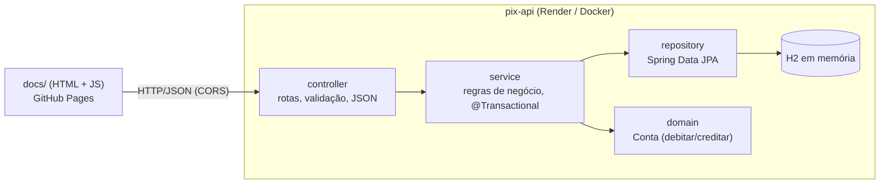

# pix-api

API REST de estudo que simula contas e transferências Pix, feita com **Spring Boot 4 + Java 17**,
com um front-end estático em [`docs/`](docs/) publicado no GitHub Pages.

| | Link |
|---|---|
| Front-end (GitHub Pages) | https://rafaelnicolauios.github.io/pix-api/ |
| API (Render) | https://pix-api-vfy6.onrender.com |
| Código | https://github.com/RafaelNicolauiOS/pix-api |

> A API roda no plano gratuito do Render: depois de ~15 min sem uso ela "dorme", e a primeira
> requisição leva ~50 s para acordar. A página mostra "Acordando o servidor…" enquanto isso.

## Stack

- **Java 17** (Eclipse Temurin) e **Spring Boot 4.1.2**: Web MVC, Data JPA, Validation
- **H2** em memória como banco de dados
- **JUnit 5 + Mockito + MockMvc** para testes (desenvolvidos com TDD)
- **Maven** via wrapper (`./mvnw`), sem precisar instalar o Maven
- **Docker** + **Render** para a API; **GitHub Pages** para o front-end (HTML + JS puro, sem build)

## Arquitetura

Arquitetura em camadas: cada camada só conversa com a de baixo.



| Pacote | Responsabilidade | Paralelo com iOS/Swift |
|---|---|---|
| `controller` | Recebe HTTP, valida DTOs (`@Valid`), converte exceções em ProblemDetail | Camada de rede/API |
| `controller.dto` | `record`s de entrada/saída: a API não expõe a entidade JPA | `Codable` structs |
| `service` | Casos de uso: CRUD de contas e transferência (transacional) | ViewModel / UseCase |
| `repository` | Acesso ao banco; o Spring gera a implementação a partir da interface | DataSource / Core Data |
| `domain` | Entidade `Conta` com as regras que a protegem (saldo nunca fica negativo) | Model |
| `config` | CORS e carga das contas de exemplo | `AppDelegate` / configuração |

<details>
<summary>Estrutura de arquivos</summary>

```
pix-api/
├── src/main/java/com/rafael/pixapi/
│   ├── PixApiApplication.java
│   ├── config/        CorsConfig, DadosIniciais
│   ├── controller/    ContaController, TransferenciaController, ApiExceptionHandler
│   │   └── dto/       ContaRequest, ContaResponse, TransferenciaRequest
│   ├── service/       ContaService, TransferenciaService, ComprovanteTransferencia, exceções
│   ├── repository/    ContaRepository
│   └── domain/        Conta, SaldoInsuficienteException
├── src/main/resources/application.properties
├── src/test/java/...  testes (ver "Como testar")
├── docs/              front-end: index.html, app.js, style.css
├── Dockerfile
├── render.yaml
└── pom.xml
```
</details>

### Decisões importantes

- **Transferência transacional:** `TransferenciaService.transferir` é `@Transactional`: débito e
  crédito são "tudo ou nada". Se o débito falhar (saldo insuficiente), nada é gravado. Não há
  `save()` explícito: o JPA detecta as mudanças nas entidades ("dirty checking") e grava no commit.
- **Concorrência:** as contas são lidas com `SELECT ... FOR UPDATE` (`@Lock(PESSIMISTIC_WRITE)`)
  e travadas sempre em ordem alfabética da chave, para evitar gasto duplo e deadlock.
- **Dinheiro em `BigDecimal`**, nunca `double`, com valor limitado a 2 casas decimais.
- **Regra no domínio:** só `Conta.debitar()` / `Conta.creditar()` alteram o saldo (encapsulamento).
- **Erros no padrão [RFC 9457 – Problem Details](https://www.rfc-editor.org/rfc/rfc9457)**
  (`application/problem+json`), centralizados em `ApiExceptionHandler`.
- **Dados de exemplo** via `CommandLineRunner` (`config/DadosIniciais.java`) em vez de `data.sql`:
  reaproveita o construtor da entidade e só insere quando o banco está vazio.
- **CORS** liberado só para `https://rafaelnicolauios.github.io` e `localhost` (qualquer porta).

## Endpoints

| Método | Rota | Corpo | Respostas |
|---|---|---|---|
| `GET` | `/contas` | — | 200 |
| `GET` | `/contas/{id}` | — | 200 · 404 |
| `POST` | `/contas` | `{titular, cpf, chavePix, saldo}` | 201 + `Location` · 400 · 409 |
| `PUT` | `/contas/{id}` | `{titular, cpf, chavePix, saldo}` (altera titular e chave) | 200 · 400 · 404 · 409 |
| `DELETE` | `/contas/{id}` | — | 204 · 404 |
| `POST` | `/transferencias` | `{chaveOrigem, chaveDestino, valor}` | 200 · 400 · 404 · 422 |

| Status | Quando |
|---|---|
| 400 | Dados inválidos: campo vazio, CPF sem 11 dígitos, saldo negativo, valor ≤ 0 ou com mais de 2 casas |
| 404 | Conta ou chave Pix não encontrada |
| 409 | Chave Pix já cadastrada |
| 422 | Saldo insuficiente, ou chave de origem igual à de destino |

Contas de exemplo carregadas ao iniciar:

| Titular | Chave Pix | Saldo |
|---|---|---|
| Ana Souza | `ana@pix.com` | R$ 1.000,00 |
| Bruno Lima | `bruno@pix.com` | R$ 250,00 |
| Carla Dias | `+5511999990000` | R$ 50,00 |

<details>
<summary>Exemplos de resposta</summary>

Transferência com sucesso (`200`):

```json
{
  "chaveOrigem": "ana@pix.com",
  "chaveDestino": "bruno@pix.com",
  "valor": 100.50,
  "saldoOrigem": 899.50,
  "realizadaEm": "2026-10-25T14:43:59.442257Z"
}
```

Saldo insuficiente (`422`, `application/problem+json`):

```json
{
  "title": "Saldo insuficiente",
  "status": 422,
  "detail": "Saldo insuficiente na chave +5511999990000 para transferir R$ 50.01",
  "instance": "/transferencias"
}
```

Dados inválidos (`400`):

```json
{
  "title": "Bad Request",
  "status": 400,
  "detail": "Dados inválidos",
  "instance": "/contas",
  "erros": {
    "cpf": "deve conter 11 dígitos",
    "saldo": "deve ser maior ou igual a 0",
    "titular": "não deve estar em branco"
  }
}
```
</details>

## Como rodar localmente

Pré-requisito: JDK 17.

```bash
brew install --cask temurin@17
```

E no `~/.zshrc`:

```bash
export JAVA_HOME=$(/usr/libexec/java_home -v 17)
export PATH="$JAVA_HOME/bin:$PATH"
```

Subir a API:

```bash
./mvnw spring-boot:run
```

- API: http://localhost:8080
- Console do banco: http://localhost:8080/h2-console (JDBC URL `jdbc:h2:mem:pixdb`, usuário `sa`, senha vazia)

Subir o front-end (em outro terminal):

```bash
python3 -m http.server 8000 --directory docs
```

Abra http://localhost:8000. Rodando local, a página usa `http://localhost:8080` automaticamente.

## Como testar

```bash
./mvnw test
```

**39 testes**, todos escritos antes da implementação (TDD: vermelho → verde):

| Teste | Tipo | Qtd. | O que cobre |
|---|---|---|---|
| `domain/ContaTest` | Unidade pura | 4 | Débito, crédito e saldo insuficiente |
| `service/ContaServiceTest` | Unidade com Mockito | 9 | CRUD e chave Pix duplicada, com repositório mockado |
| `service/TransferenciaServiceTest` | Unidade com Mockito | 5 | Débito/crédito, saldo insuficiente, chave inexistente, origem = destino |
| `controller/ContaControllerTest` | `@WebMvcTest` | 9 | Rotas, status, JSON e validação de contas |
| `controller/TransferenciaControllerTest` | `@WebMvcTest` | 5 | 200, 400, 404 e 422 no formato ProblemDetail |
| `config/CorsConfigTest` | `@WebMvcTest` | 3 | GitHub Pages e localhost permitidos, outros domínios bloqueados |
| `TransferenciaIntegrationTest` | `@SpringBootTest` + H2 | 3 | Débito/crédito gravados de verdade, rollback e contas de exemplo |
| `PixApiApplicationTests` | `@SpringBootTest` | 1 | A aplicação sobe |

### Teste manual com curl

Local (troque por `https://pix-api-vfy6.onrender.com` para testar em produção):

```bash
API=http://localhost:8080
```

Listar contas:

```bash
curl -s $API/contas
```

Transferência com sucesso:

```bash
curl -s -X POST $API/transferencias -H 'Content-Type: application/json' -d '{"chaveOrigem":"ana@pix.com","chaveDestino":"bruno@pix.com","valor":100.50}'
```

Saldo insuficiente (422):

```bash
curl -s -X POST $API/transferencias -H 'Content-Type: application/json' -d '{"chaveOrigem":"+5511999990000","chaveDestino":"ana@pix.com","valor":999}'
```

Chave inexistente (404):

```bash
curl -s -X POST $API/transferencias -H 'Content-Type: application/json' -d '{"chaveOrigem":"ana@pix.com","chaveDestino":"ninguem@pix.com","valor":1}'
```

## Configuração

Propriedades em [`application.properties`](src/main/resources/application.properties),
sobrescrevíveis por variáveis de ambiente:

| Propriedade | Variável de ambiente | Padrão | Uso |
|---|---|---|---|
| `server.port` | `PORT` | `8080` | Porta HTTP (o Render define `PORT`) |
| `pix.cors.origens` | `PIX_CORS_ORIGENS` | GitHub Pages + `localhost:*` | Origens liberadas no CORS (separadas por vírgula) |
| `spring.h2.console.enabled` | `H2_CONSOLE` | `true` | Console do H2 (`false` em produção) |
| `spring.jpa.show-sql` | `SHOW_SQL` | `true` | Log do SQL gerado (`false` em produção) |
| `pix.seed.enabled` | `PIX_SEED_ENABLED` | `true` | Carga das contas de exemplo |

## Deploy

Todo `git push` na `main` publica as duas partes automaticamente: o Render refaz o deploy da API
(`autoDeploy: true`) e o GitHub Pages republica `docs/`.

### Código no GitHub (via SSH)

O repositório precisa existir vazio no GitHub (crie em https://github.com/new, sem README).
Depois, dentro da pasta `pix-api`:

```bash
git remote add origin git@github.com:RafaelNicolauiOS/pix-api.git
```

```bash
git push -u origin main
```

### API no Render

1. No [Render](https://dashboard.render.com): **New → Blueprint** → selecione o repositório.
2. Em **Blueprint Name** digite `pix-api`; deixe **Branch** = `main` e **Blueprint Path** em branco.
3. **Deploy Blueprint.** O [`render.yaml`](render.yaml) cria o web service usando o
   [`Dockerfile`](Dockerfile) (build multi-stage: compila com JDK, roda só com JRE, sem root).
   O primeiro build leva de 5 a 10 minutos; o serviço está pronto quando o status fica **Live**.
4. Se o nome já estiver em uso, o Render acrescenta um sufixo à URL (aqui ficou
   `pix-api-vfy6.onrender.com`). Copie a URL do topo da página do serviço para `API_PRODUCAO` em
   [`docs/app.js`](docs/app.js).

### Front-end no GitHub Pages

No **repositório** (não nas configurações do perfil):
**Settings → Pages → Build and deployment → Deploy from a branch → `main` / `/docs` → Save.**

Em 1–2 minutos fica disponível em https://rafaelnicolauios.github.io/pix-api/. O repositório
precisa ser público no plano gratuito.

## Solução de problemas

| Sintoma | Causa / solução |
|---|---|
| `fatal: not a git repository` | O comando rodou fora da pasta do projeto. Entre em `pix-api/` antes. |
| Tela "Pages → Verified domains" | Essas são as configurações da **conta**. O Pages se ativa em Settings do **repositório**. |
| Página: "Sem conexão com a API" | API dormindo (aguarde ~1 min), URL errada no campo "URL da API" ou origem fora do CORS. |
| `404` com header `x-render-routing: no-server` | Não há serviço nessa URL do Render: confira a URL real no dashboard. |
| Página usa uma URL antiga da API | O botão **Salvar** guarda a URL no navegador (`localStorage`). Corrija o campo e salve de novo. |
| Contas voltaram aos valores iniciais | Esperado: o H2 é em memória e zera a cada reinício/deploy. |
| Build Maven falha com `Non-resolvable parent POM` | A versão do Spring Boot no `pom.xml` deve ser `4.1.2` (sem sufixo `.RELEASE`). |

## Limitações

- **Sem persistência:** H2 em memória, os dados voltam às contas de exemplo a cada reinício.
- **Sem histórico:** transferências não são registradas; só os saldos mudam.
- **Sem autenticação:** qualquer pessoa com acesso à página pode cadastrar, excluir e transferir.
- **Cold start** de ~50 s no plano gratuito do Render.

## Próximos passos

- PostgreSQL + Flyway para persistir os dados (o Render oferece um PostgreSQL gratuito).
- Entidade `Transferencia` com histórico e um `GET /contas/{id}/extrato`.
- Idempotência no `POST /transferencias` (header `Idempotency-Key`) para evitar duplicidade em retries.
- GitHub Actions rodando `./mvnw test` a cada push e bloqueando o deploy se falhar.
- Autenticação (Spring Security) para que cada usuário só movimente a própria conta.
